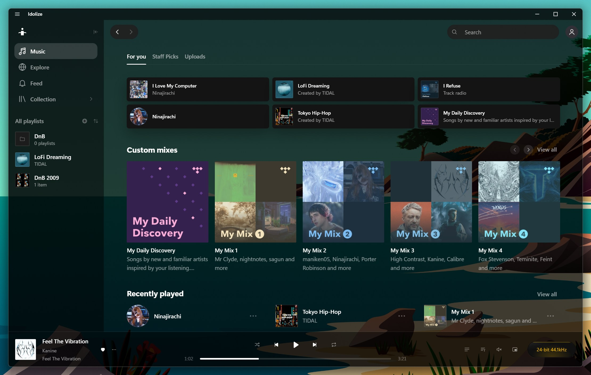

# Idolize

An unofficial desktop player for TIDAL subscribers, made for Windows: see-through windows, a light show for every
song, and hi-res lossless playback.



> **Idolize is an independent project.** It is not affiliated with, endorsed by or sponsored by TIDAL. "TIDAL" is a
> trademark of its owner. Idolize doesn't host or provide any music: you sign in with your own TIDAL account and need
> an active subscription. Using an unofficial client may be against TIDAL's terms of use, so use it at your own risk.

**[Download the latest release](https://github.com/BreakLime/idolize/releases/latest)** (Windows 10/11, x64)

## Features

- **See-through window:** Clear (no blur), Acrylic or Mica, with an adjustable tint.
- **Transparent player:** the player shows your desktop behind it, sharp or blurred.
- **A light show for every song:** the album cover becomes an LED wall, in sync with the music.
- **Synced lyrics and the song's top YouTube comments** in the light show.
- **Hi-res lossless:** up to 24-bit FLAC.

## Download

Get the installer or the portable `.exe` from the [latest release](https://github.com/BreakLime/idolize/releases/latest).
The builds aren't code-signed yet, so Windows SmartScreen may warn on the first start: choose *More info → Run
anyway*.

macOS and Linux: coming soon.

## Build from source

You need [Node.js](https://nodejs.org/) 24 and Windows.

```sh
npm ci
npm run dev        # run it with hot reload
npm run dist       # build the installer and the portable exe into dist/
```

Checks: `npm run typecheck` and `npm test` (unit tests). The end-to-end tests (`npm run e2e`) drive the real app and
need a signed-in TIDAL account.

## Privacy

Idolize talks to TIDAL for your account, library and music. For the stage's comments it searches the song's artist and
title on YouTube (anonymously); you can turn that off in Settings → General. Nothing else leaves your computer.

## License

[MIT](LICENSE)
